# MS41 Simulator 1.0.0

Simulateur du calculateur moteur **BMW MS41** (moteurs M52 et S52, processeur Siemens SAB 80C166W à 12 MHz).
Il exécute le **vrai firmware** lu dans un calculateur, instruction par instruction, avec les puces de la carte
(flash, RAM, décodeur d'adresse, EEPROM, contrôleur CAN, microcontrôleur satellite), un moteur virtuel branché sur
ses broches et une ligne K pour le diagnostic. Rien n'est « imité » à partir d'une analyse du programme : c'est le
firmware lui-même qui tourne et pilote le moteur virtuel, comme dans la voiture.

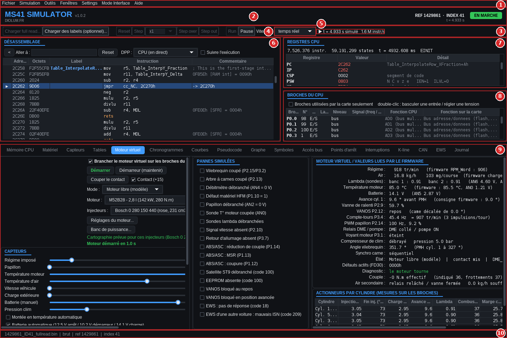

## Ce que l'on peut faire

- **Suivre le firmware pas à pas** : désassemblage, registres, mémoire telle que le CPU la voit, points d'arrêt,
  interruptions, accès bus, pseudocode et graphe de flot des fonctions.
- **Voir les tables de calibration vivre** : avec une définition RomRaider, les cellules lues par le calculateur
  s'allument en direct.
- **Faire tourner un moteur virtuel** : M52B20, B25, B28 ou S52B32 (M3 E36 US), injecteurs au choix, démarrage à
  froid ou à chaud, ralenti, accélérations, VANOS, cliquetis, pannes de capteurs, air secondaire des versions US.
- **L'entendre** (trois échappements) et le **passer au banc de puissance**.
- **Observer les signaux** : chronogrammes des broches, courbes des capteurs et des valeurs du firmware.
- **Dialoguer en K-line** avec **MS41 ECU Tool v1.1.5**, intégré : identification, codes défaut, lecture et écriture
  de la flash.

## Aperçu

### Moteur virtuel

Le moteur est simulé cycle par cycle : remplissage calculé degré par degré à partir des soupapes et du calage,
combustion, film d'essence sur les parois, sondes lambda, cliquetis, température d'échappement. Le calculateur ne
voit que ses broches : vilebrequin, came, débitmètre, papillon, sondes, et il commande injecteurs, bobines, vanne de
ralenti et VANOS.

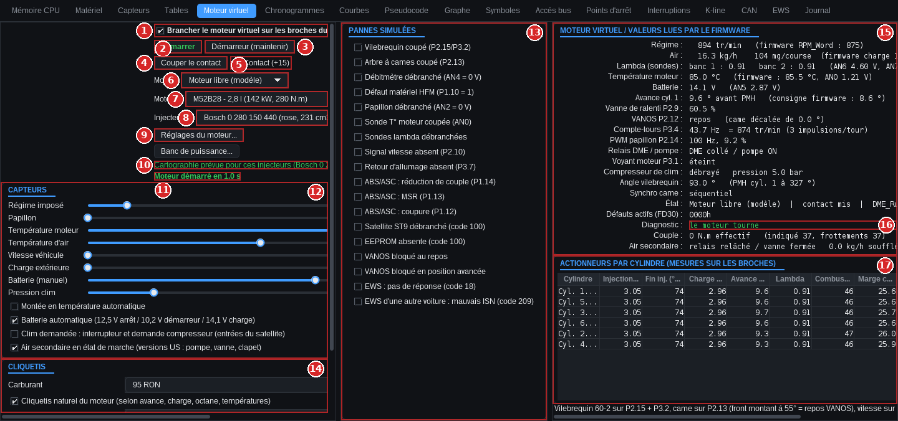

Fiche constructeur de chaque moteur (géométrie, embiellage, arbres à cames, injecteurs), avec la source de chaque
valeur, et moteur personnalisé (cylindrée, collecteur, injecteurs, compression) :

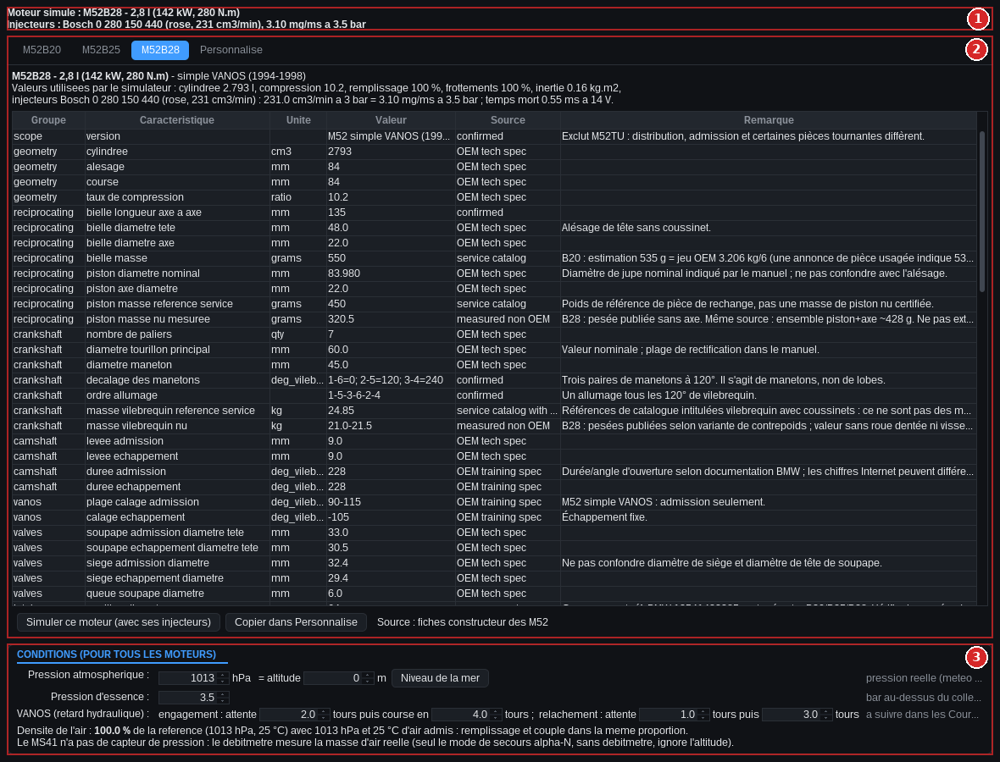

### Banc de puissance

Frein virtuel à courants de Foucault : paliers de régime ou tir pleine charge, couple et puissance comparés aux
valeurs constructeur.

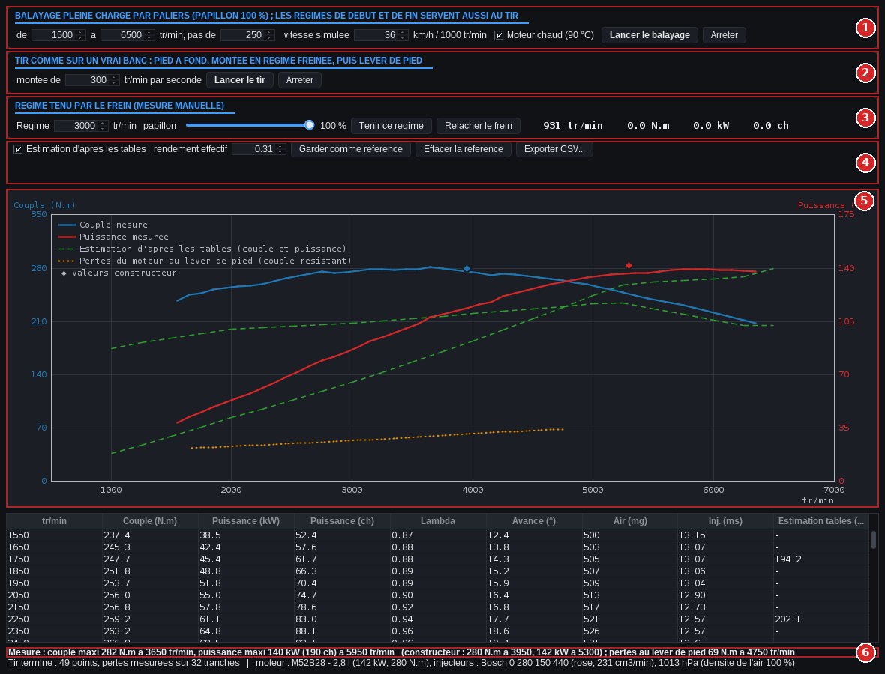

### Tables de calibration

Avec une définition RomRaider, chaque table de la calibration s'affiche ; les cellules lues par le calculateur sont
surlignées en direct.

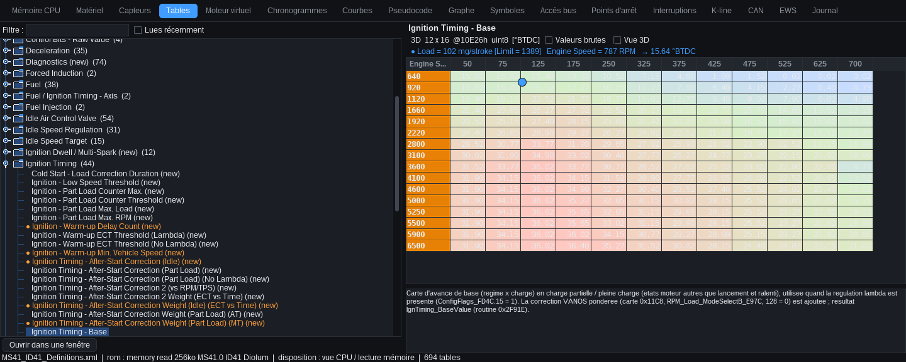

### Désassemblage, pseudocode et graphe

Désassembleur du C166 vérifié instruction par instruction contre un listing de référence. Pseudocode structuré
(`if` / `else`, boucles `while` et `do … while`, conditions reconstruites) et graphe de flot façon IDA : flèches vertes
pour un saut pris, rouges pour un saut non pris, boucles contournées par la droite.

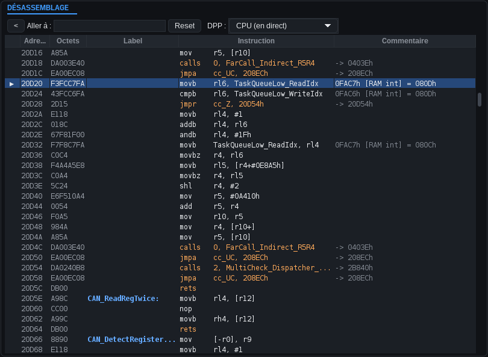

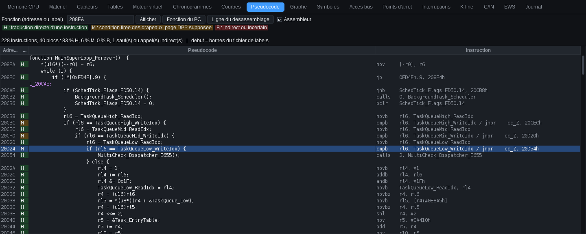

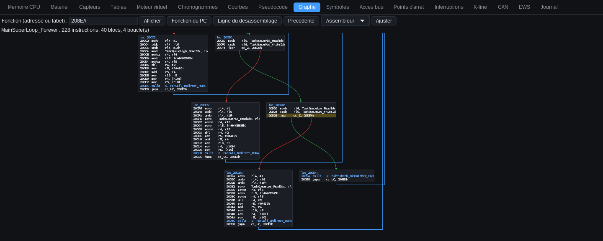

### Chronogrammes et courbes

Signaux logiques des broches (vilebrequin 60-2, came, bobines, injecteurs…) et évolution des capteurs et des
valeurs du firmware.

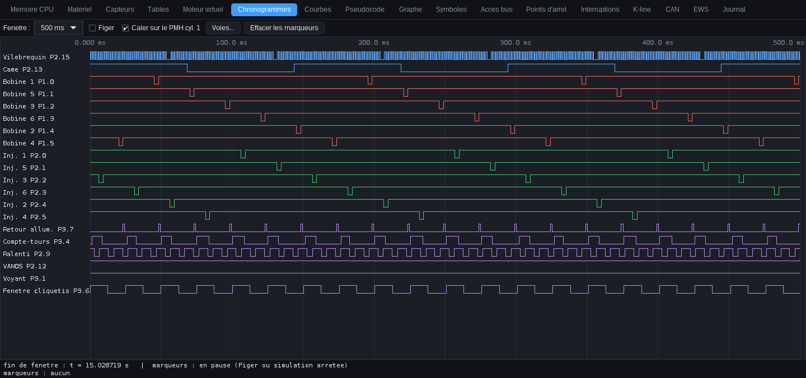

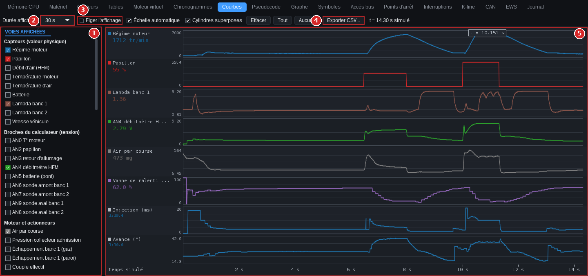

### Matériel de la carte

Une vue par boîtier : CPU, flash, RAM, décodeur d'adresse PLCC, EEPROM, avec l'activité en direct.

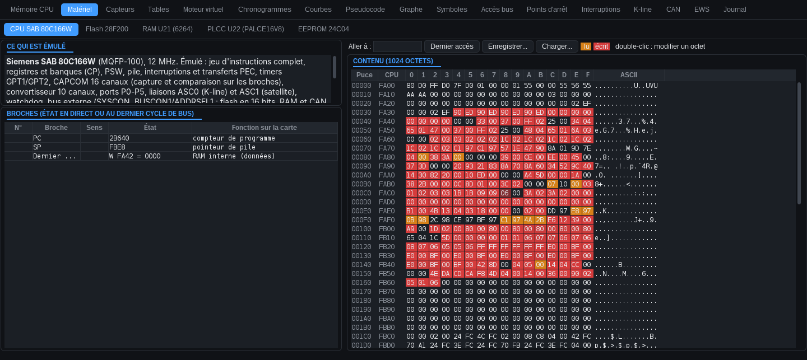

### Capteurs

Une fiche par capteur et actionneur : principe, références BMW, caractéristiques modifiables (couronne du
vilebrequin, loi du papillon, courbes des sondes).

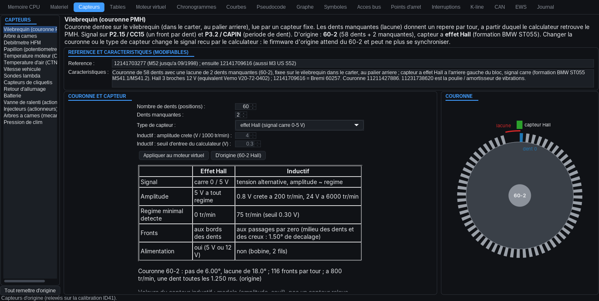

### Diagnostic K-line et MS41 ECU Tool

La ligne K virtuelle est reliée à MS41 ECU Tool, intégré au simulateur : identification, lecture des défauts,
lecture et écriture de la flash, comme sur un vrai calculateur.

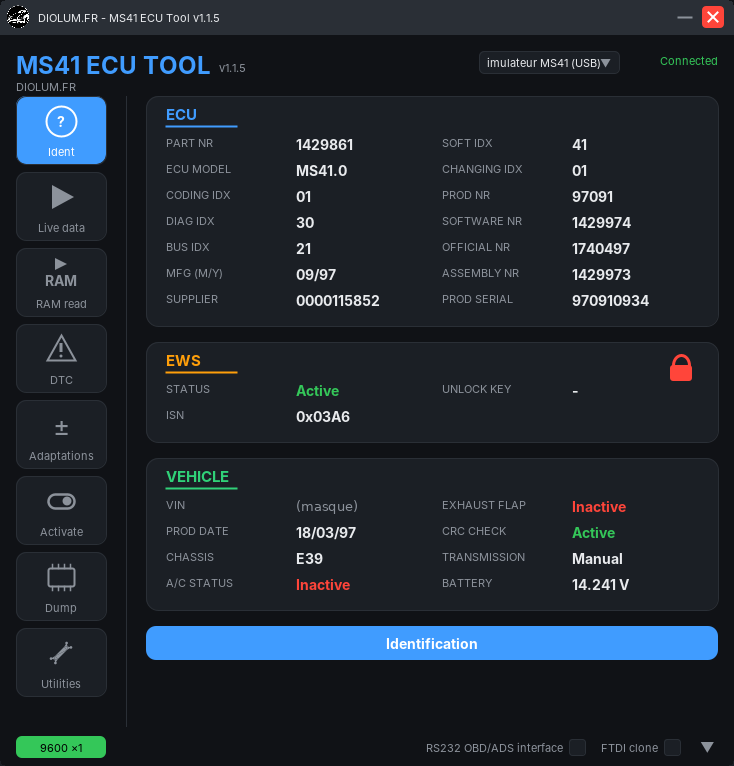

### Son du moteur

Son synthétisé en direct à partir de ce que fait le moteur (chaque combustion, ratés, démarreur, pops au lever de
pied), avec trois échappements : origine, X-pipe + silencieux race, silencieux race.

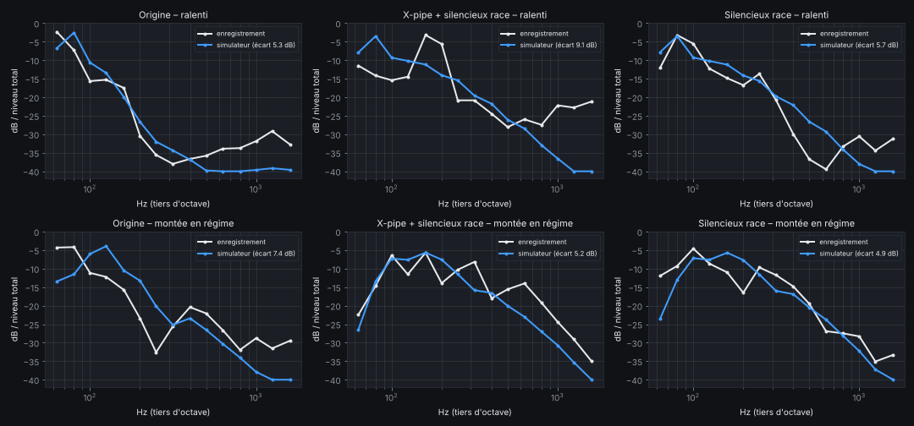

## Prérequis

- **Java 8 ou plus récent** (par exemple [Eclipse Temurin](https://adoptium.net)).
- macOS, Windows ou Linux.
- Un **full read** de calculateur MS41 (fichier de 256 Ko). Aucun n'est fourni.
- Pour l'onglet Tables : une **définition RomRaider** (fichier XML) de la calibration. Aucune n'est fournie.
- Facultatif : une manette (Xbox, PlayStation…) pour piloter l'accélérateur.

## Installation et lancement

1. Télécharger ce dépôt : bouton vert **Code** en haut de la page, puis **Download ZIP**.
2. Décompresser le ZIP où l'on veut (il contient un dossier `MS41-Simulator-M52--main`).
3. Dans ce dossier, double-clic sur `MS41Simulator.jar`
   (ou dans un terminal, depuis le dossier : `java -jar MS41Simulator.jar`).

Garder les fichiers ensemble : le simulateur cherche `lib/` et `docs/` à côté de `MS41Simulator.jar`.

## Premiers pas

1. *Fichier > Charger full read…* : choisir son full read (lecture brute de la puce ou vue CPU, détectée seule).
2. Facultatif : créer le dossier `docs/definitions/` à côté du jar et y placer sa définition RomRaider (chargée
   automatiquement au chargement du full read), ou *Fichier > Charger une définition RomRaider*.
3. Onglet *Moteur virtuel* : choisir le moteur et les injecteurs, puis **Démarrer**.
4. *Aide > Guide utilisateur* (F1) : le guide illustré complet s'ouvre dans le navigateur
   (aussi lisible ici : [docs/Guide_utilisateur/index.html](docs/Guide_utilisateur/index.html), à ouvrir après
   téléchargement).

## Contenu du dépôt

| Élément | Rôle |
|---|---|
| `MS41Simulator.jar` | le simulateur (avec MS41 ECU Tool v1.1.5) |
| `docs/Guide_utilisateur/` | guide utilisateur (Aide > Guide) et ses captures, utilisées aussi par ce README |
| `lib/` | bibliothèques pour les manettes (JNA, SDL2) et leurs licences |

Créés à l'usage à côté du jar : `docs/definitions/` (à créer soi-même, pour sa définition RomRaider),
`data/eeprom/` (EEPROM simulées enregistrées, créé automatiquement) et `ms41_ecu_tool.log` (journal de MS41 ECU Tool).

## Remarques

- Le code source n'est pas publié : seul l'exécutable est distribué.
- Les réglages (fenêtres, thème sombre ou clair, son, manette, capteurs) sont gardés d'un lancement à l'autre.
- Les cartographies européennes (MS41.0) et américaines (MS41.1 / MS41.2, avec air secondaire) sont acceptées.
- Limites connues : voir le chapitre *Limites actuelles* du guide.

© Diolum.fr – [diolum.fr](https://diolum.fr)
